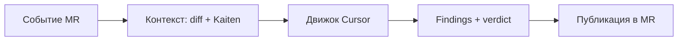

# Обзор продукта

## TL;DR

**Mira** — автономный сервис «первого прохода» код-ревью для Merge Request'ов в
self-hosted GitLab. Он собирает diff MR и контекст связанной задачи Kaiten, прогоняет
анализ через Cursor и возвращает структурированные находки с вердиктом. Это
**консультативный** ассистент: не блокирует merge и не подменяет человека.

## Ценность в одной фразе

Событие в MR → контекст (diff + карточка Kaiten) → анализ Cursor по юнитам →
структурированные находки → публикация ревью обратно в MR (и опционально в Kaiten).

## Проблема

Ручное ревью Merge Request'ов — узкое место: ревьюеры перегружены, часть багов
утекает в `main`, а соответствие кода исходной задаче (бизнес-требованиям из
Kaiten) проверяется непоследовательно. Нужен автоматический «первый проход», который
снимает рутину с людей и ловит типовые проблемы до того, как до MR дойдёт человек.

## Что мы строим

На каждое значимое изменение в MR Mira:

1. Понимает **что должно было быть сделано** — забирает связанную задачу из Kaiten
   (описание, критерии приёмки).
2. Понимает **что фактически сделано** — забирает diff MR, изменённые файлы и
   нужный контекст репозитория.
3. **Думает как senior-ревьюер** — через Cursor (CLI headless сейчас, SDK позже)
   ищет баги, регрессии, проблемы безопасности/производительности и расхождения с
   задачей.
4. **Возвращает результат** — публикует структурированные комментарии в MR (по
   возможности — inline к строкам) и сводку-вердикт; опционально дублирует сводку
   в карточку Kaiten.

## Цели (Goals)

- **G1.** Сократить время до первого ревью MR (бот отвечает за минуты, а не часы).
- **G2.** Повысить долю пойманных багов/регрессий **до** человеческого ревью.
- **G3.** Проверять соответствие изменений **исходной задаче** Kaiten, а не только
  «код ради кода».
- **G4.** Дать **гибкую** архитектуру: легко менять движок (CLI ↔ SDK ↔ cloud),
  трекер задач, VCS и способ публикации.
- **G5.** Работать **без GitLab CI/CD pipelines** — отдельный сервис на выделенном
  сервере.

## Границы: что Mira **не** делает (Non-goals)

| # | Не делаем | Пояснение |
| --- | --- | --- |
| N1 | Не подменяем CI | Тесты/линтеры не запускаем как обязательный этап (можем читать их результаты как контекст). |
| N2 | Не gate и не auto-merge | Не выполняем merge, не ставим approve, не пушим правки в ветку MR автоматически (auto-fix — опциональная поздняя фаза). |
| N3 | Не строим UI в MVP | Взаимодействие через комментарии MR и Kaiten. |
| N4 | Не претендуем на 100% точность | Ассистивный инструмент; ложные срабатывания допустимы и управляются настройками строгости. |

Дополнительно:

- **Не job в GitLab CI/CD** — триггеры и оркестрация живут вне `.gitlab-ci.yml`.
- **Не merge gate** — решение о merge принимает человек; Mira даёт консультативное
  ревью и снижает риск внедрения.
- **Kaiten — read-only** под текущим личным токеном; запись обратной связи в
  Kaiten допустима только через будущий сервис-аккаунт (см.
  [../05-operations/security.md](../05-operations/security.md)).

## Ключевые принципы проектирования

1. **Pluggable everything.** Триггер, VCS-провайдер, трекер задач, движок ревью и
   публикатор — за интерфейсами. GitLab/Kaiten/Cursor — сменные адаптеры, а не
   жёсткие зависимости ядра.
2. **Идемпотентность.** Один и тот же коммит MR не ревьюится дважды; повторный
   запуск обновляет/дополняет, а не плодит дубликаты комментариев.
3. **Stateless worker + внешнее состояние.** Воркер не хранит состояние в памяти
   между задачами; всё — в state store. Это даёт горизонтальное масштабирование.
4. **Эфемерные воркспейсы.** Каждый MR ревьюится в свежем изолированном checkout,
   который удаляется после задачи.
5. **Деградация, а не отказ.** Нет связанной задачи Kaiten? Ревьюим по diff.
   Не достаём один файл? Ревьюим то, что достали, и помечаем пропуск.
6. **Безопасность по умолчанию.** Минимальные права токенов, секреты вне репозитория,
   контроль сетевого egress, изоляция выполнения агента.

## Пользователи и сценарии

| Роль | Сценарий |
| --- | --- |
| Разработчик-автор MR | Открывает MR → через минуты получает структурированное ревью и список рисков; правит до прихода человека. |
| Ревьюер-человек | Видит pre-review бота, фокусируется на сложных местах, а не на рутине. |
| Тимлид | Видит сводку в Kaiten, отслеживает качество и метрики ревью по команде. |
| Сам бот (Mira) | По команде `@mira review` перезапускает ревью или отвечает на уточнение в треде MR. |

## Критерии успеха

- Время от события MR до публикации ревью — целевое ≤ 3–5 минут на средний MR.
- Доля MR, где ревью бота содержит хотя бы одну принятую человеком находку.
- Доля ложных срабатываний (false positives) — управляется и снижается со временем.
- Нет дубликатов комментариев при повторных пушах в ветку.

## Связанные материалы

- Требования и ограничения — [requirements.md](./requirements.md)
- Глоссарий домена — [domain-glossary.md](./domain-glossary.md)
- Дорожная карта — [roadmap.md](./roadmap.md)
- Архитектура — [../04-architecture/overview.md](../04-architecture/overview.md)
- Типы домена (справочник) — [../03-reference/domain-types.md](../03-reference/domain-types.md)
