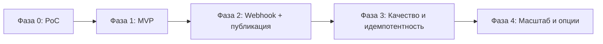

# Дорожная карта

Фазы развития Mira, риски, принятые решения. **Детальный статус задач** — единственный
источник правды: [../../tasks/execution-order.md](../../tasks/execution-order.md).
Здесь — стратегия и критерии выхода, без дублирования per-task прогресса.

## 1. Фазы

### Фаза 0 — PoC (доказать ценность движка)

- Скрипт: вручную задаём `project + mr_iid`, тянем diff (локальный git) + задачу
  Kaiten (MCP read), запускаем `cursor-agent -p --output-format json` с
  промптом-ревьюером, печатаем `findings.json`.
- Никакой публикации, очередей, БД. Цель — оценить качество находок и стоимость.
- **Критерий выхода:** на 5–10 реальных MR находки осмысленны, формат стабилен.

### Фаза 1 — MVP (автономный, read-only GitLab, polling)

- Триггер: **polling** открытых MR (работает на read-only доступе к GitLab).
- Движок: **CLI headless** за портом `ReviewEngine`.
- Контекст: diff + задача Kaiten + резолвер связи MR↔карточка.
- Декомпозиция: **упрощённая** — один task-scope + чанкинг по размеру (`by_task:
  single`), без synthesis-прохода.
- Вывод: **dry-run** — находки в лог (в MR пока не пишем).
- State store: SQLite, идемпотентность по `(mr, sha)`.
- **Критерий выхода:** стабильно крутится на сервере, не дублирует, метрики идут.

> Текущий прогресс по задачам фаз 0–1 — [../../tasks/execution-order.md](../../tasks/execution-order.md).

### Фаза 2 — Webhook + публикация в MR

- Триггер: **webhook** (MR + Note), polling как страховка.
- Публикация в MR: **GitLab REST write под bot-аккаунтом** — сводный комментарий +
  inline-дискуссии, идемпотентно.
- ChatOps: `@mira review`, `@mira ignore <fp>`.
- **Критерий выхода:** секундная реакция, корректная идемпотентная публикация.

### Фаза 3 — Качество и устойчивость

- Переключение дефолтного движка на **SDK local**: различение ошибок, многопроходный
  анализ, лучшая наблюдаемость.
- **Полная декомпозиция:** группировка по задачам (`commit-map`), параллельные юниты,
  агрегация, опциональный synthesis-проход для крупных/multi-task MR.
- Подстройка промптов/порогов по метрикам accepted/dismissed.
- Очередь на Redis, несколько воркеров, debounce, dead-letter, алерты.
- Per-repo `.mira/config.yml`, версии промптов.
- **Критерий выхода:** управляемый false-positive rate, целевая латентность под нагрузкой.

### Фаза 4 — Масштаб и опциональные возможности

- **Cloud-движок** для отдельных проектов, если позволит ИБ.
- Опциональный **auto-fix** (бот предлагает патч/открывает MR с правками) — строго
  ограниченно по правам и веткам.
- Расширение GitLab MCP до write для унификации, если решим.
- Дашборд/Canvas активных ревью.

## 2. Матрица «вариант → фаза»

| Решение | MVP (Ф1) | Ф2 | Ф3 | Ф4 |
| --- | --- | --- | --- | --- |
| Триггер | polling | webhook | webhook+poll | + |
| Движок | CLI (A) | CLI (A) | SDK (B) | +Cloud (C) |
| Публикация в MR | нет (dry-run) | REST write | REST write | +MCP write (W1) |
| Очередь | in-process | in-process/Redis | Redis | Redis |
| State store | SQLite | SQLite | Postgres | Postgres |

## 3. Риски и снижение

| Риск | Влияние | Снижение |
| --- | --- | --- |
| Изменение политики egress на Cursor API (Q-3 — сейчас разрешён) | Стал бы блокером для CLI/SDK/cloud | Egress firewall только на Cursor/GitLab/Kaiten; запасной план — self-hosted модель; точечные исключения репо |
| Высокий false-positive rate | Падение доверия | Пороги строгости, confidence, игнор-лист, итерации промпта |
| Шум/дубликаты комментариев | Раздражение команды | Идемпотентность по fingerprint, сводный комментарий, debounce |
| Большие MR / стоимость | Долго и дорого | Лимит diff, чанкинг, дедуп запусков, фикс модели |
| Нет надёжной связи MR↔Kaiten (Q-2) | Слабая проверка требований | Канон-конвенция (ветка+ссылка), многоступенчатый резолвер, деградация |
| Prompt injection из репо/MR | Манипуляция выводом | Жёсткая роль, детерминированный Publisher, агент без write |
| Недоступность write в GitLab MCP (Q-1) | Нельзя публиковать через MCP | Прямой REST под bot-токеном |
| Лимиты GitLab/Cursor API | Сбои под нагрузкой | Rate-limit, backoff, очередь, конкурентность |

## 4. Ключевые решения (Q-1…Q-7)

Все основные развилки **закрыты**:

| # | Вопрос | Решение |
| --- | --- | --- |
| Q-1 | Как публиковать в GitLab? | **Выделенный GitLab-аккаунт бота** (Mira) для read/write/discovery; публикация — REST под токеном этого аккаунта. |
| Q-2 | Канон связи MR↔Kaiten? | **ID карточки в имени ветки + ссылка на карточку в описании MR**; резолвер многоступенчатый. |
| Q-3 | Egress кода на Cursor API? | **Разрешён.** Основа архитектуры (local-runtime + Grok 4.6 Fast) подтверждена. |
| Q-4 | Auto-fix или комментарии? | **Консультативные комментарии** + опциональный Approve бота как сигнал тимлиду (не gate); auto-fix — потенциальная Фаза 4. |
| Q-5 | Язык сервиса? | **TypeScript** (`@cursor/sdk`); Python — альтернатива. |
| Q-6 | Enrollment проектов? | Пилот — `explicit` на 1–3 репо; раскатка — `membership` (бот-аккаунт в группе). |
| Q-7 | Модель? | **Cursor Grok 4.6 Fast** (`cursor-grok-4.6[fast=true]`; effort — дефолт модели). |

Остаточные операционные уточнения (не блокируют старт):

- Точная **роль bot-аккаунта** в GitLab (Reporter vs Developer) — проверить на
  инстансе, хватает ли прав на заметки/дискуссии в MR.
- Существующий **формат имени веток** — подстроить `branch_regex` под него.

## 5. Первые шаги (actionable)

1. **Завести GitLab-аккаунт бота** (Mira) — единый принципал для read/write/discovery;
   выдать доступ к пилотным репозиториям, проверить право писать заметки в MR.
2. Получить `CURSOR_API_KEY` с доступом к `cursor-grok-4.6` Fast; подтвердить сетевой доступ
   сервера до Cursor API.
3. Закрепить конвенцию связи MR↔Kaiten (Q-2) и обновить **шаблон описания MR**.
4. Прогнать Фазу 0 (PoC) на 5–10 реальных MR, оценить качество и стоимость.
5. По итогам PoC — MVP (Фаза 1); далее — фазы 2+ по [../../tasks/execution-order.md](../../tasks/execution-order.md).

## 6. Будущие развилки (на потом)

- Self-hosted исполнение модели, если egress окажется недопустим.
- Второй VCS/трекер через адаптеры (архитектура уже готова).
- Обучаемые под команду политики (накопление accepted/dismissed → автоподстройка).
- Интеграция с человеческим review-процессом (саммэри в Kaiten, метрики тимлиду).

## Связанные материалы

- Обзор и границы — [overview.md](./overview.md)
- Требования — [requirements.md](./requirements.md)
- Глоссарий — [domain-glossary.md](./domain-glossary.md)
- ADR и архитектурные решения — [../04-architecture/adr/README.md](../04-architecture/adr/README.md)
- Безопасность — [../05-operations/security.md](../05-operations/security.md)
- Статус задач — [../../tasks/execution-order.md](../../tasks/execution-order.md)
