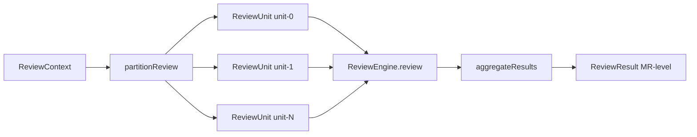
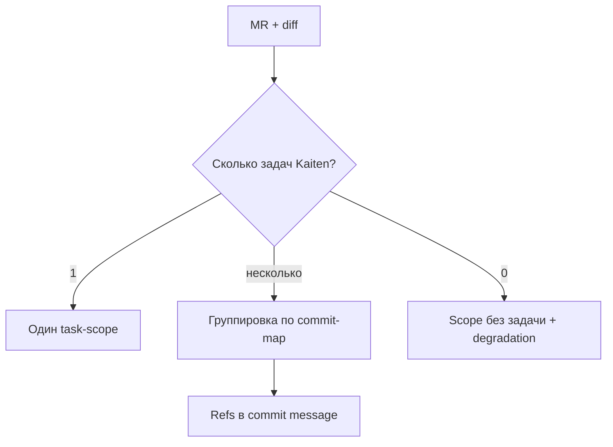
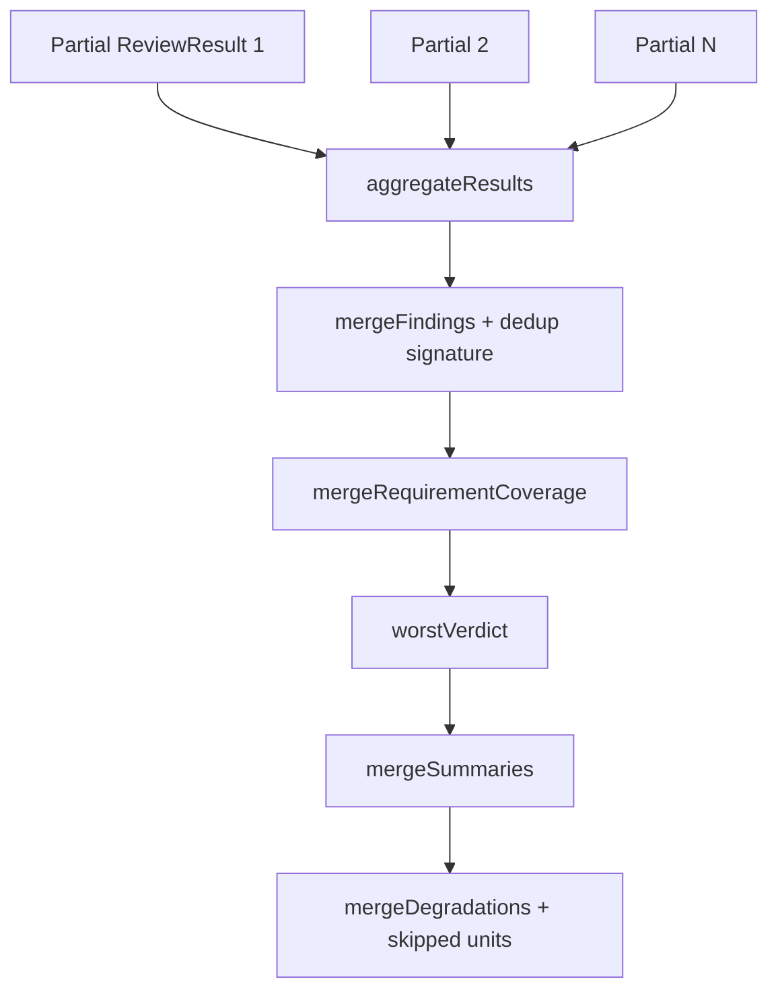

# Декомпозиция ревью и бюджет контекста

Большой MR нельзя надёжно ревьюить «одним куском»: diff может не влезть в
контекстное окно модели, растёт стоимость и падает точность. Mira **режет**
`ReviewContext` на ограниченные **`ReviewUnit`**, запускает движок **по юнитам** и
**агрегирует** частичные `ReviewResult` в один.

Этап стоит между Context Builder и Review Engine в pipeline — см.
[review-pipeline.md](./review-pipeline.md).

## MVP vs целевое состояние

| Возможность | MVP (фаза 0–1) | Целевое |
| --- | --- | --- |
| Режим декомposition | `decomposition.mode: 'single'` только | `commit-map`, `heuristic`, multi-task |
| Ось «по задачам Kaiten» | Весь MR — один task-scope | Группировка hunks по карточкам |
| Чанкинг по размеру | ✅ на границах **файлов** | + split по hunks для oversized файлов |
| `max_units` cap | ❌ не enforced | Лимит юнитов + «не вошло» в сводке |
| Параллельные юниты | ❌ последовательный цикл | `max_parallel_units_per_mr` |
| Synthesis-проход | ❌ | Лёгкий cross-unit pass по сводкам |

Код MVP: `src/core/partition/partition.ts`, `src/core/aggregate/aggregate.ts`.
Версия в `ReviewKey`: `partitionVersion = 'single.v1'`.

## Поток данных



## Две оси декомпозиции (концепция)

| Ось | Что делит | Зачем |
| --- | --- | --- |
| **Логическая (по задачам)** | Diff → scopes по карточкам Kaiten | Фокус на критериях приёмки, корректный `requirements_coverage` |
| **Физическая (по размеру)** | Diff внутри scope → чанки | Влезть в бюджет контекста Composer 2.5 |

**MVP реализует только физическую ось** в mode `single`: одна логическая задача
(вся карточка из linking, если есть) + чанки по байт-бюджету.

### Целевая логическая декомпозиция (не MVP)



Стратегии (будущие): `single` | `commit-map` | `heuristic` — см.
[adr/010-mr-kaiten-linking.md](./adr/010-mr-kaiten-linking.md).

---

## Бюджет контекста (MVP)

### Модель

На один запуск агента (один `ReviewUnit`):

```text
B_окно (Composer 2.5)
  = B_система (промпт review.v1.md + JSON-схема)
  + B_задача (критерии Kaiten, если card есть)
  + B_diff (инъектируемый diff чанка)     ← управляется partition
  + B_контекст (файлы, которые агент читает сам в checkout)
  + B_вывод (резерв под findings JSON)
```

MVP **жёстко ограничивает B_diff** параметром политики:

```yaml
context_budget:
  max_chunk_tokens: 60000   # в режиме estimate: bytes — лимит байт diff
  estimate: bytes           # bytes | tokenizer (tokenizer — позже)
```

Defaults: `src/core/policy/defaults.ts`. Справочник —
[../03-reference/policy-config.md](../03-reference/policy-config.md).

`estimateContentSize` (`partition.ts`):

- `bytes` → `Buffer.byteLength(content, 'utf8')`;
- `tokenizer` → `ceil(bytes / 4)` (грубая оценка, зарезервировано).

### Что отсекается до партиционирования

1. **Бинарные файлы** (`ChangedFile.isBinary`) — исключаются.
2. **`ignoredGlobs`** — lock-файлы, `dist/`, `*.min.js` и т.д. (policy + `matchesAny`).
3. Пустой / whitespace-only diff → **0 юнитов** (pipeline → «No reviewable changes»).

---

## Алгоритм `partitionReview` (реализован)

Детерминированный, воспроизводимый порядок — важен для идемпотентности
([review-pipeline.md](./review-pipeline.md)).

```text
partitionReview(context, { ignoredGlobs, contextBudget }):
  eligibleFiles = changedFiles \ binary \ ignored_globs
  if empty → return []

  sections = parseDiffSections(unified diff)
    .filter(path ∈ eligible)
    .sort(path)                    // localeCompare — стабильный порядок

  bucket = [], size = 0
  for section in sections:
    sectionSize = estimate(section.content, estimate_mode)

    if sectionSize > maxChunk:
      flush bucket
      emit unit with ONLY this file (oversized — целиком, degradation implicit)
      continue

    if size + sectionSize > maxChunk:
      flush bucket

    add section to bucket; size += sectionSize

  flush bucket
  return units with ids unit-0, unit-1, …
```

### Правила

| Правило | MVP |
| --- | --- |
| Не резать hunk между юнитами | ✅ секции = целые файлы из diff |
| Файл целиком в одном юните, если влезает | ✅ |
| Oversized файл (> maxChunk) | Отдельный юнит с **полным** файлом (может превысить бюджет) |
| Стабильность | Сортировка путей + детерминированный flush |
| `max_units` | 🔜 не реализован |

`parseDiffSections` режет unified diff по маркерам `diff --git a/… b/…`.

### ReviewUnit

```typescript
// концептуально
{ id: 'unit-0', context: ReviewContext }  // подмножество diff + changedFiles
```

Каждый unit несёт копию метаданных MR и опционально ту же `card` Kaiten.

---

## Агрегация (`aggregateResults`)

Код: `src/core/aggregate/aggregate.ts`.



### Правила слияния (реализованы)

| Поле | Правило |
| --- | --- |
| **findings** | Union; dedup по `category\|filePath\|message` (не fingerprint) |
| **requirements_coverage** | По критерию — худший статус (`missing` > `partial` > …) |
| **verdict** | Худший: `blockers` > `risks` > `ok` |
| **summary** | Одна часть — как есть; несколько — `[Unit i] …` |
| **degradations** | Union + `Skipped review units: id1, id2` |

После aggregate pipeline вызывает **`normalizeFindings`** — dedup уже по
**fingerprint** (SHA-256) для публикации и store.

### Пустые / failed юниты

- Все юниты упали → игривый summary «не смогла, обновите ключи» + degradation
  `engine-unavailable` (без пустого «OK / 0 findings» в MR).
- Частичный успех → findings успешных юнитов + degradation про пропущенные.

---

## Кросс-чанковые баги (компромисс)

Разбиение может скрыть баг между файлами из разных юнитов.

| Митigation | MVP | Целевое |
| --- | --- | --- |
| Группировка связанных файлов (module/directory) | 🔜 только sort by path | `group_by: module` |
| Synthesis-проход по сводкам юнитов | ❌ | `synthesis: true` в политике |
| Прозрачность в summary | Partial — через `[Unit N]` prefixes | + явная пометка «ревью разбито» |

---

## Параллелизм

| Аспект | MVP | Целевое |
| --- | --- | --- |
| Юниты одного MR | Последовательно в `for` loop pipeline | Параллельно с лимитом `max_parallel_units_per_mr` |
| Checkout | Один `workspaceDir` read-only для всех юнитов | То же |
| Слоты ресурсов | `MAX_CONCURRENCY` на worker | Отдельный budget на MR |

---

## Идемпотентность и версии

- Разбиение **должно быть детерминированным** для одного `(MR, SHA, partition_version, policy)`.
- Fingerprint находки **не зависит** от номера юнита — привязка к содержимому
  (`category|filePath|message`).
- Bump `partition_version` (например `single.v1` → `commit-map.v1`) инвалидирует
  прошлые `seen()` и запускает переревью того же SHA.

Константа в `main.ts`: `PARTITION_VERSION = 'single.v1'`.

---

## Поведение на разных размерах MR

| Размер MR | MVP (`single`) |
| --- | --- |
| Маленький (diff < maxChunk) | 1 юнит |
| Средний | Несколько юнитов по файловым границам |
| Файл > maxChunk | 1 юнит = весь файл (может превысить бюджет) |
| Все файлы ignored | 0 юнитов → skip content |
| Очень большой MR | 🔜 без `max_units` — все eligible файлы попадут в юниты (риск стоимости) |

> Целевое: при превышении `max_units` — приоритетные юниты + секция «не вошло» в
> summary.

---

## Конфигурация (ориентир)

MVP в типах (`src/core/policy/types.ts`):

```yaml
context_budget:
  max_chunk_tokens: 60000
  estimate: bytes

decomposition:
  mode: single          # единственный поддерживаемый режим
```

Расширенная целевая конфигурация (из design doc, **не полностью в коде**):

```yaml
decomposition:
  by_task: commit-map
  max_units: 12
  max_parallel_units_per_mr: 3
  group_by: module
  synthesis: true
  partition_version: "part.v1"
```

Per-repo override — `.mira/config.yml` (см. policy merge в `core/policy/`).

---

## Связанные материалы

- Linking MR ↔ Kaiten — [adr/010-mr-kaiten-linking.md](./adr/010-mr-kaiten-linking.md)
- Модель и окно контекста — [adr/005-fixed-model-composer-2-5.md](./adr/005-fixed-model-composer-2-5.md)
- Схема `requirements_coverage` — [../03-reference/finding-schema.md](../03-reference/finding-schema.md)
