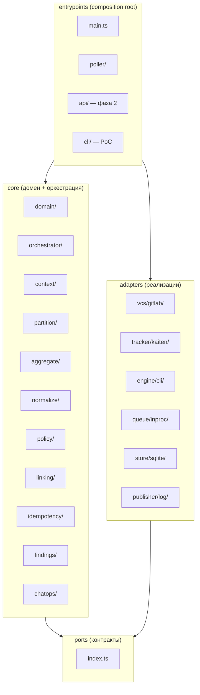
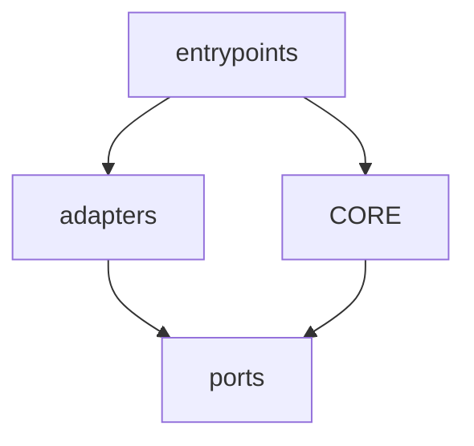
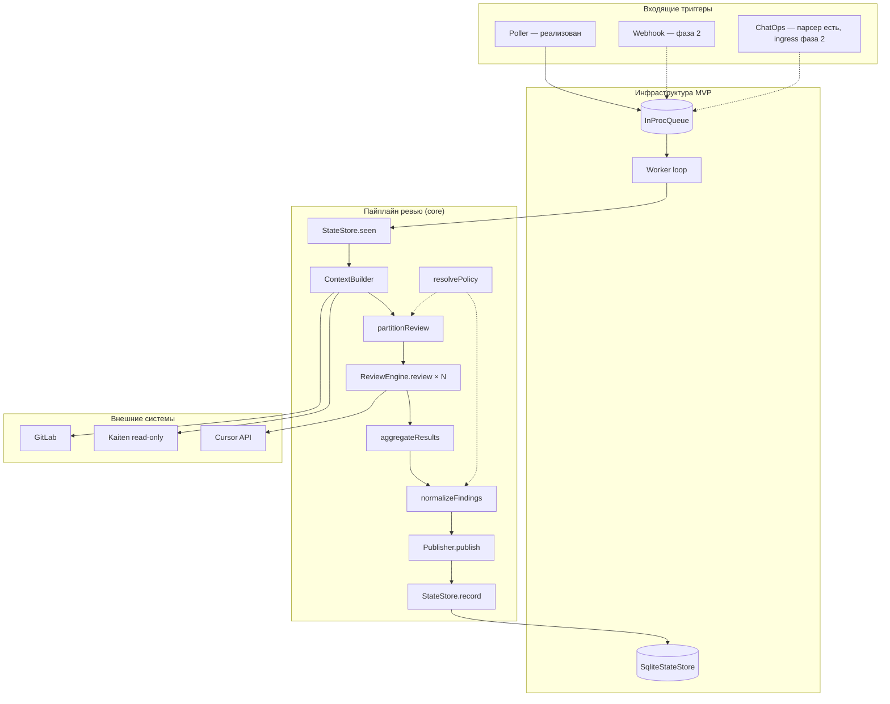
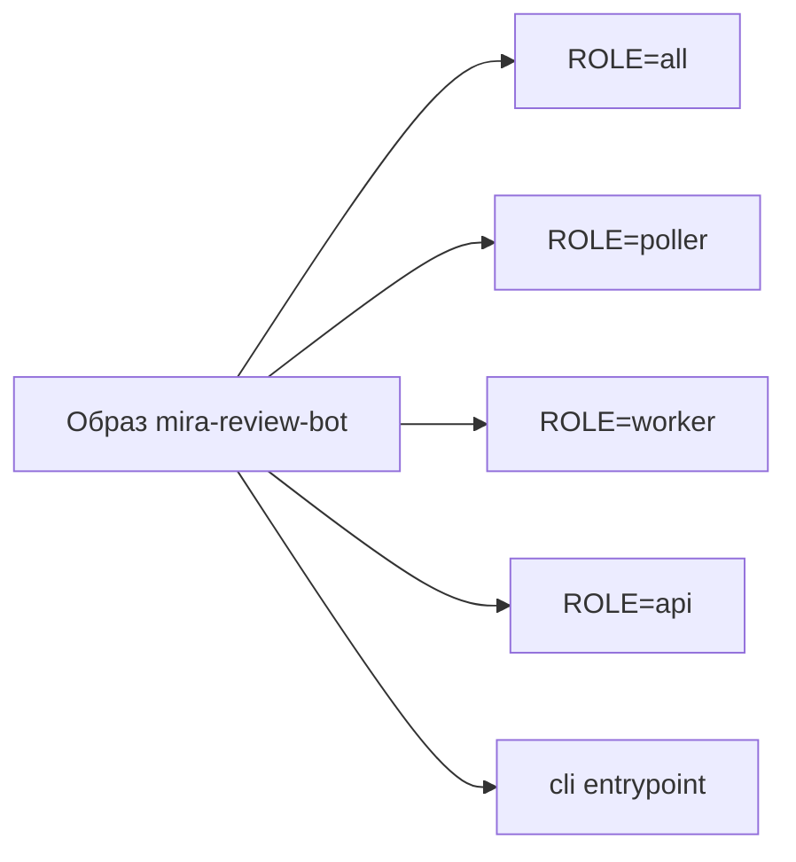
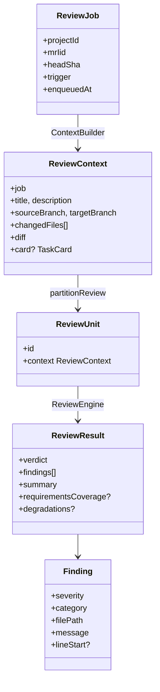
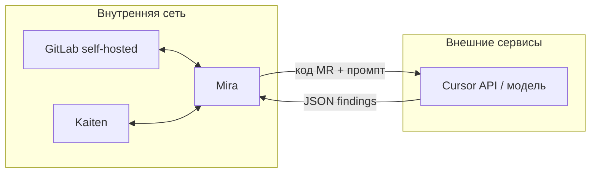

# Обзор архитектуры

Mira Review Bot — автономный сервис AI-код-ревью для GitLab MR в контексте задачи
Kaiten. Движок ревью — Cursor (сейчас **CLI headless**, позже SDK/cloud). Код —
**TypeScript ESM**, Node ≥ 24. Организация — **гексагональная архитектура**
(ядро + порты + адаптеры) внутри **модульного монолита**: один образ, несколько
ролей процесса.

> Продуктовый контекст — [../01-concepts/overview.md](../01-concepts/overview.md).
> Обоснование ключевых решений — [adr/README.md](./adr/README.md).

## Главный инвариант: гексагон

Ядро не знает, что VCS — GitLab, трекер — Kaiten, движок — Cursor. Оно оперирует
**портами** (интерфейсами в `src/core/ports/index.ts`); конкретные системы
подключаются **адаптерами** в `src/adapters/*`. **Composition root** один —
`src/entrypoints/main.ts` связывает core и адаптеры по конфигу и поднимает процесс
выбранной роли.



### Правило зависимостей



| Слой | Может зависеть от | Не должен зависеть от |
| --- | --- | --- |
| `core/*` | `core/domain`, `core/ports`, другие чистые модули `core` | GitLab, Kaiten, Cursor, HTTP, SQLite напрямую |
| `adapters/*` | `core/ports`, `core/domain`, SDK/HTTP клиентов | `entrypoints`, бизнес-логику оркестрации |
| `entrypoints/*` | `core`, `adapters`, `config`, `observability` | — (единственное место «склейки») |

Зависимости направлены **внутрь, к ядру**. Смена адаптера (например, CLI → SDK)
не требует переписывания пайплайна — см.
[adr/004-review-engine-port-cli-then-sdk.md](./adr/004-review-engine-port-cli-then-sdk.md).

## Карта компонентов



### Соответствие компонентов и каталогов

| Компонент | Назначение | Код (фаза 0–1) | Статус |
| --- | --- | --- | --- |
| Ingress: Poller | Discovery открытых MR → `ReviewJob` | `src/entrypoints/poller/`, `selectJobs` | ✅ MVP |
| Ingress: Webhook | HTTP-приём GitLab hooks | `src/entrypoints/api/webhook.ts`, `server.ts` | 🔜 фаза 2 (не подключён в `main.ts`) |
| Ingress: ChatOps | `@mira review`, `@mira ignore` | `src/core/chatops/parse.ts` | 🔜 парсер готов, ingress — фаза 2 |
| Job Queue | Буфер триггер → worker, dedup по `JobKey` | `src/adapters/queue/inproc/` | ✅ in-process |
| Worker | Bounded-concurrency loop | `src/core/orchestrator/worker.ts` | ✅ |
| Orchestrator / Pipeline | Один `ReviewJob` → результат | `src/core/orchestrator/pipeline.ts` | ✅ |
| Context Builder | MR + diff + Kaiten + checkout | `src/core/context/` | ✅ |
| Linking MR ↔ Kaiten | Резолвер карточки | `src/core/linking/` | ✅ |
| Partitioner | `ReviewContext` → `ReviewUnit[]` | `src/core/partition/` | ✅ mode `single` |
| Aggregator | Частичные результаты → один | `src/core/aggregate/` | ✅ |
| Normalize | Фильтры, пороги, dedup, cap | `src/core/normalize/` | ✅ |
| Review Engine | `review(context) → ReviewResult` | `src/adapters/engine/cli/` | ✅ CLI |
| Publisher | Публикация находок | `src/adapters/publisher/log/` | ✅ dry-run |
| GitLab Publisher | MR summary + inline | `src/adapters/publisher/gitlab/` | 🔜 фаза 2 |
| State Store | Идемпотентность запуска и находок | `src/adapters/store/sqlite/` | ✅ SQLite |
| Policy / Config | `review_on`, strictness, бюджет | `src/core/policy/`, `src/config/` | ✅ |
| Observability | JSON-лог, метрики, redact | `src/observability/` | ✅ |

Полные контракты портов — [../03-reference/ports.md](../03-reference/ports.md).

## Процессы и роли (`ROLE`)

Один деплоимый образ; поведение выбирается переменной окружения `ROLE` в
`src/entrypoints/main.ts`:

| `ROLE` | Что поднимается | Назначение |
| --- | --- | --- |
| `all` (default) | poller + worker + `/healthz` | MVP «всё в одном» |
| `poller` | Только опрос GitLab → enqueue | Отдельный процесс discovery |
| `worker` | Только консьюмер очереди | Горизонтальное масштабирование ревью |
| `api` | Только `/healthz` | Webhook-эндпоинт — фаза 2 |



Дополнительно: `src/entrypoints/cli/` — ручной прогон ревью без очереди (PoC и
отладка), см. [../02-guides/run-review-poc.md](../02-guides/run-review-poc.md).

Константы поведения в composition root:

- `PROMPT_VERSION = 'review.v1'` — шаблон в `prompts/review.v1.md`
- `PARTITION_VERSION = 'single.v1'` — режим декомпозиции MVP

Обе версии входят в `ReviewKey` для идемпотентности (см.
[review-pipeline.md](./review-pipeline.md)).

## Дерево `src/` (фактическое)

```text
src/
  config/                 # loadConfig(), policy-config (YAML)
  core/
    domain/               # ReviewJob, ReviewContext, Finding, ReviewResult, …
    ports/                # VcsReader, ReviewEngine, Queue, StateStore, …
    orchestrator/         # createReviewPipeline, runWorker
    context/              # ContextBuilder, checkout, workspace
    partition/            # partitionReview, glob-фильтры
    aggregate/            # aggregateResults
    normalize/            # normalizeFindings
    idempotency/          # findingFingerprint
    linking/              # MR ↔ Kaiten
    policy/               # resolvePolicy, defaults, merge
    findings/             # validateFindings (JSON Schema)
    chatops/              # parseChatOps
  adapters/
    vcs/gitlab/         # reader (+ writer для фазы 2)
    tracker/kaiten/       # read-only KaitenTracker
    engine/cli/           # CliHeadlessEngine
    engine/sdk/           # .gitkeep — фаза 2+
    engine/cloud/         # .gitkeep — позже
    queue/inproc/         # InProcQueue
    store/sqlite/         # SqliteStateStore
    publisher/log/        # LogPublisher (dry-run)
    publisher/gitlab/     # GitLabPublisher — фаза 2
  entrypoints/
    main.ts               # composition root
    poller/               # runPoller, selectJobs
    api/                  # webhook, debounce, server — фаза 2
    cli/                  # poc runner
  observability/          # logger, metrics, redact
```

## Модель данных (ключевые сущности)



Типы и поля — [../03-reference/domain-types.md](../03-reference/domain-types.md).

## Границы доверия и egress



При local-runtime через CLI **код MR уходит в Cursor API** — это согласовано с
политикой egress, см.
[adr/011-cursor-api-egress-allowed.md](./adr/011-cursor-api-egress-allowed.md) и
[../05-operations/security.md](../05-operations/security.md).

Kaiten под личным токеном — **строго read-only**:
[adr/008-kaiten-read-only.md](./adr/008-kaiten-read-only.md).

## Масштабирование и отказоустойчивость

- **Worker stateless:** состояние — в `StateStore` (SQLite); воркспейсы эфемерны.
- **Горизонтально:** несколько `ROLE=worker` с общей очередью (Redis — позже;
  сейчас `InProcQueue` только в одном процессе).
- **Конкурентность:** `MAX_CONCURRENCY` (default 1); юниты одного MR в MVP
  обрабатываются **последовательно** в цикле pipeline.
- **Деградация вместо отказа:** ошибка одного юнита → degradation note, остальные
  юниты продолжают; см. [review-pipeline.md](./review-pipeline.md).
- **Изоляция:** каждый MR — отдельный checkout под `WORKSPACE_ROOT` / tmp.

## Принципы реализации

| Принцип | Как соблюдается |
| --- | --- |
| Ядро без сети в тестах | Fake-порты в `src/core/ports/fakes.ts`, unit-тесты co-located `src/**/*.test.ts` |
| Тонкие адаптеры | Бизнес-логика только в `core`; адаптер — трансляция API |
| Один composition root | Зависимости только в `entrypoints/main.ts` |
| Типизированный конфиг | Ранний fail при старте (`loadConfig`, `PolicyConfigError`) |
| Версионирование поведения | `prompt_version`, `partition_version` в `ReviewKey` |

## Куда дальше

- Сквозной поток одного ревью — [review-pipeline.md](./review-pipeline.md)
- Триггеры и политика `review_on` — [triggers.md](./triggers.md)
- Декомпозиция MR — [decomposition-context-budget.md](./decomposition-context-budget.md)
