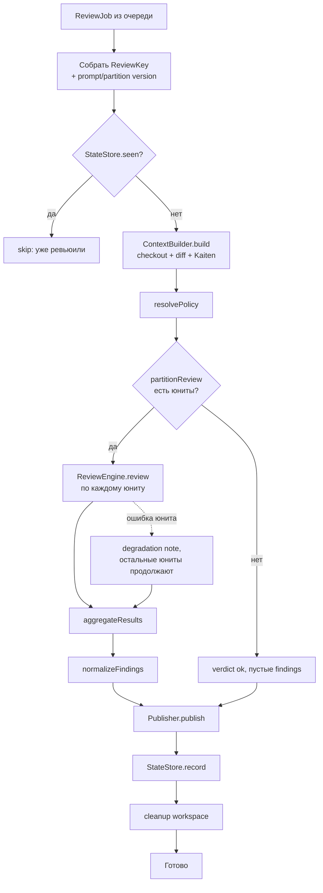
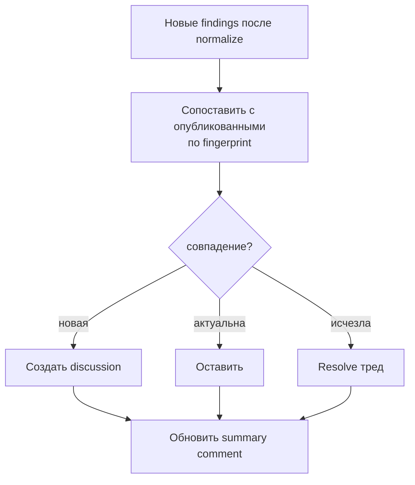
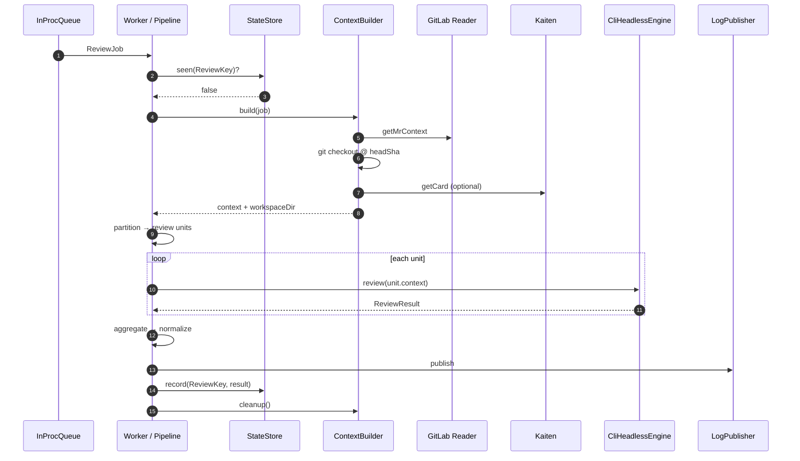

# Пайплайн ревью

Документ описывает жизненный цикл **одного** `ReviewJob` внутри воркера: от
извлечения из очереди до записи результата и очистки воркспейса. Реализация —
`createReviewPipeline` в `src/core/orchestrator/pipeline.ts`; цикл воркера —
`runWorker` в `src/core/orchestrator/worker.ts`.

> Архитектурный контекст — [overview.md](./overview.md).
> Триггеры и постановка в очередь — [triggers.md](./triggers.md).
> Декомпозиция на юниты — [decomposition-context-budget.md](./decomposition-context-budget.md).

## Схема этапов (фаза 0–1)



### Порядок шагов в коде

| # | Шаг | Модуль | Примечание |
| --- | --- | --- | --- |
| 1 | Построить `ReviewKey` | `pipeline.ts` | `(projectId, mrIid, headSha, promptVersion, partitionVersion)` |
| 2 | `store.seen(key)` | `adapters/store/sqlite/` | Идемпотентность запуска |
| 3 | `contextBuilder.build(job)` | `core/context/` | Эфемерный checkout, unified diff, опционально `TaskCard` |
| 4 | `resolvePolicy(projectId)` | `core/policy/` | `ignoredGlobs`, `contextBudget`, `strictness` |
| 5 | `partitionReview(context, …)` | `core/partition/` | MVP: mode `single`, чанки по байт-бюджету |
| 6 | `engine.review(unit.context)` | `adapters/engine/cli/` | **Последовательно** по юнитам |
| 7 | `aggregateResults(…)` | `core/aggregate/` | Дедуп, худший verdict, merge coverage |
| 8 | `normalizeFindings(…)` | `core/normalize/` | globs → severity → fingerprint dedup → cap |
| 9 | `publisher.publish({ job, result })` | `adapters/publisher/log/` | MVP: dry-run в лог |
| 10 | `store.record(key, result)` | `adapters/store/sqlite/` | Фиксация + fingerprints находок |
| 11 | `built.cleanup()` | `finally` | Удаление воркспейса |

> **Не реализовано в MVP pipeline:** явная проверка «бот включён для проекта»
> (pilot-проекты задаются через `discovery.projects` в политике); параллельный
> запуск юнитов; публикация в GitLab (`GitLabPublisher` — фаза 2).

## Context Builder и воркспейс

`ContextBuilder` (`src/core/context/context-builder.ts`):

1. Читает метаданные MR через `VcsReader.getMrContext`.
2. Клонирует репозиторий и делает checkout на `headSha` (`prepareCheckout`).
3. Строит unified diff относительно target-ветки.
4. Резолвит карточку Kaiten через `core/linking` (если ссылка найдена в MR).
5. Опционально пишет `.mira/context.json` в воркспейс для агента.

Результат — `ContextBuildResult`:

- `context: ReviewContext` — вход partition/engine;
- `workspaceDir` — корень checkout (передаётся в `CliHeadlessEngine`);
- `cleanup()` — удаление директории (вызывается в `finally` pipeline).

**Деградация:** если карточка Kaiten недоступна, ревью продолжается по diff;
отсутствие задачи отражается в `degradations` результата движка или в summary.

## Review Engine

Контракт порта `ReviewEngine`:

```text
review(context: ReviewContext) → Promise<ReviewResult>
```

MVP-реализация — `CliHeadlessEngine` (`src/adapters/engine/cli/`): запуск
`cursor-agent` с промптом из `prompts/review.v1.md`, парсинг JSON по схеме
[../03-reference/finding-schema.md](../03-reference/finding-schema.md).

| Реализация | Статус |
| --- | --- |
| `CliHeadlessEngine` | ✅ фаза 0–1 |
| `SdkLocalEngine` | 🔜 фаза 2+ (`src/adapters/engine/sdk/`) |
| `CloudEngine` | 🔜 позже |

См. [adr/004-review-engine-port-cli-then-sdk.md](./adr/004-review-engine-port-cli-then-sdk.md).

**Обработка ошибок юнита:** исключение из `engine.review` не роняет весь job.
ID юнита попадает в `skippedUnitIds`; aggregator добавляет degradation
«Skipped review units: …». Метрика `engine_errors_total` инкрементируется через
hooks pipeline.

## Aggregate и Normalize

### Aggregate (`aggregateResults`)

- **Findings:** объединение с дедупом по сигнатуре `category|filePath|message`
  (на этапе aggregate — до fingerprint).
- **Verdict:** худший по рангу (`blockers` > `risks` > `ok`).
- **requirements_coverage:** по каждому критерию — худший статус
  (`missing` > `partial` > `unknown` > `met`).
- **Summary:** склейка сводок юнитов с префиксами `[Unit N]`.
- **Degradations:** union со всех юнитов + пропущенные юниты.

### Normalize (`normalizeFindings`)

После aggregate, перед publish:

1. Отброс по `ignoredGlobs` (повторная фильтрация путей находок).
2. Порог `strictness`: `balanced` отсекает `nit`, `lenient` — только `blocker`/`major`.
3. Дедуп по `findingFingerprint` (`category|filePath|message` → SHA-256).
4. Cap: `DEFAULT_MAX_FINDINGS = 50` (top по severity).

Счётчики отброшенных — в лог `review.normalized` (`dropped.byGlob`, …).

## Publisher (MVP: dry-run)

`LogPublisher` (`src/adapters/publisher/log/`) пишет структурированный лог с
verdict, summary и findings — **без записи в GitLab/Kaiten**.

Целевая публикация (фаза 2):

- сводный комментарий MR с HTML-маркером `<!-- mira:summary:… -->`;
- inline-дискуссии с `<!-- mira:finding:<fingerprint> -->`;
- идемпотентное create/update/resolve через `GitLabPublisher`.

См. [adr/009-dry-run-publisher.md](./adr/009-dry-run-publisher.md).

## Идемпотентность

### Ключ запуска (`ReviewKey`)

Расширяет `JobKey` (`projectId`, `mrIid`, `headSha`) версиями поведения:

| Поле | MVP-значение | Назначение |
| --- | --- | --- |
| `promptVersion` | `review.v1` | Смена промпта → переревью того же SHA |
| `partitionVersion` | `single.v1` | Смена алгоритма разбиения → переревью |

Проверка: `StateStore.seen(key)` до тяжёлой работы. Запись: `record(key, result)`
после успешного publish.

SQLite-запрос (`MR_REVIEW`) матчит все пять полей ключа.

### Очередь vs store

| Механизм | Ключ | Когда |
| --- | --- | --- |
| `InProcQueue.enqueue` | `JobKey` (без версий) | Dedup **pending** jobs в памяти процесса |
| `StateStore.seen` | полный `ReviewKey` | Dedup **завершённых** ревью |

Повторный webhook/poll на тот же SHA после успешного `record` → `review.skip.seen`.

### Fingerprint находки (публикация)

`findingFingerprint` = SHA-256(`category|filePath|message`). **Не привязан к
номеру строки** — строки смещаются между коммитами.

Используется в:

- `normalizeFindings` — dedup перед publish;
- `SqliteStateStore.record` — таблица `FINDING_RECORD`;
- будущий `GitLabPublisher` — маркеры в MR.

Игнор пользователя: `@mira ignore <fingerprint>` → `IgnoreStore` (реализован в
SQLite store; ingress команды — фаза 2).



> Алгоритм publish — **целевой** для фазы 2; MVP останавливается на `record` + log.

## Стратегия деградации

Pipeline **не бросает** исключение для типичных частичных сбоев — итоговый job
завершается с degradation notes в `ReviewResult.degradations`:

| Ситуация | Поведение MVP |
| --- | --- |
| Все файлы ignored / пустой diff | `units.length === 0` → verdict `ok`, summary «No reviewable changes» |
| Ошибка `engine.review` на юните | Юнит в `skippedUnitIds`, остальные обрабатываются |
| Нет карточки Kaiten | Ревью по diff (linking degradation) |
| Checkout / store / publish infra error | Исключение → worker логирует, job **не** записан в store |

**Инфраструктурные ошибки** (checkout, `record`, необработанное исключение до
`record`) пробрасываются из handler — worker их логирует (`worker.error`), job
можно повторить (at-least-once semantics триггеров).

**Невалидный JSON от агента:** обрабатывается внутри `CliHeadlessEngine`
(retry/validation — см. тесты адаптера); при полном провале — ошибка юнита →
degradation path.

## State store (MVP)

`SqliteStateStore` (`src/adapters/store/sqlite/`):

- **`MR_REVIEW`** — факт обработки `(project, mr, sha, prompt_version, partition_version)`,
  verdict, summary, timestamp.
- **`FINDING_RECORD`** — fingerprints находок для аналитики и будущей
  идемпотентной публикации.
- **`IGNORE_LIST`** — fingerprints, заглушенные через ChatOps.

См. [adr/007-sqlite-state-store.md](./adr/007-sqlite-state-store.md).

## Sequence diagram (happy path)



## Гарантии

- **At-least-once** постановка задач (poll/webhook) + **идемпотентный** `seen/record`
  = безопасно при повторах.
- Воркспейс **всегда** очищается в `finally` после попытки обработки.
- Повтор на том же `ReviewKey` не меняет наблюдаемый результат (skip без `--force`;
  force/manual re-review — через bump версий или отдельный trigger `manual`, фаза 2).

## Связанные материалы

- Конфиг политики (`strictness`, `context_budget`) —
  [../03-reference/policy-config.md](../03-reference/policy-config.md)
- Метрики pipeline hooks — [../05-operations/observability.md](../05-operations/observability.md)
- Модель Composer 2.5 — [adr/005-fixed-model-composer-2-5.md](./adr/005-fixed-model-composer-2-5.md)
