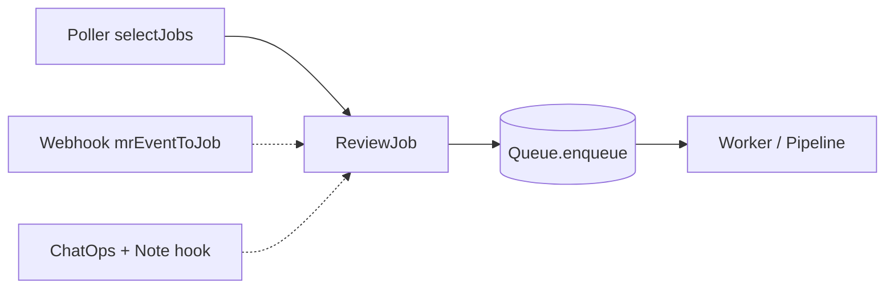
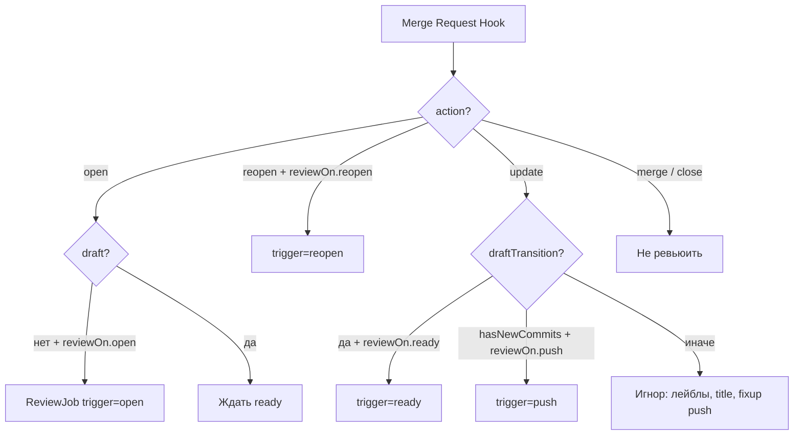

# Триггеры: как Mira узнаёт о работе

Все способы инициировать ревью сводятся к одному типу — **`ReviewJob`** в очереди.
Ядро и pipeline **не зависят** от источника события: poller, webhook или ChatOps
используют общий контракт `Queue.enqueue`.

> Ограничение продукта: **без GitLab CI/CD pipelines** (C-1) — см.
> [adr/012-no-gitlab-ci-pipelines.md](./adr/012-no-gitlab-ci-pipelines.md).
> Webhook GitLab **не является** pipeline; это интеграция уровня проекта/группы.

## Сводка вариантов

| Вариант | Латентность | Права GitLab | Статус | Роль |
| --- | --- | --- | --- | --- |
| **A. Polling** | Минуты | Read (list MR, diff) | ✅ MVP, `ROLE=poller` | Старт без webhook |
| **B. Webhook** | Секунды | Настройка hook + write (фаза 2) | 🔜 код в `entrypoints/api/`, не в `main.ts` | Целевой основной |
| **C. ChatOps** | По команде | Чтение комментариев + write ответа | 🔜 парсер в `core/chatops/` | Ре-ревью, ignore |

Рекомендация эволюции: polling → webhook (+ polling как страховка). ADR:
[adr/006-polling-trigger-mvp.md](./adr/006-polling-trigger-mvp.md).

## Нормализация: всё → ReviewJob



Поля `ReviewJob` (`src/core/domain/index.ts`):

- `projectId` — путь проекта GitLab (`path_with_namespace`);
- `mrIid`, `headSha`;
- `trigger` — `open` | `ready` | `push` | `reopen` | `poll` | `manual` | …;
- `enqueuedAt` — ISO timestamp.

`InProcQueue` dedup по `(projectId, mrIid, headSha)` для **ожидающих** jobs.

---

## Вариант A — Polling (реализован)

Код: `src/entrypoints/poller/poller.ts`, запуск из `main.ts` при `ROLE=poller|all`.

### Алгоритм

1. Каждые `POLL_INTERVAL_MS` (default **60 000** ms) для каждого pilot-проекта из
   `policyConfig.discovery.projects`:
2. `VcsMrLister.listOpenMergeRequests(projectId)` — открытые MR.
3. `selectJobs(mrs, policyFor, alreadyHandled, now)` — чистая функция отбора.
4. `queue.enqueue(job)` для каждого отобранного job.

### Логика `selectJobs` (MVP)

```text
для каждого MrSummary:
  пропустить если isDraft или state ≠ opened
  пропустить если alreadyHandled(mr)  // тот же project+mr+headSha уже enqueued/обработан в процессе
  trigger = pickInitialTrigger(policy.reviewOn):
    если reviewOn.open → 'open'
    иначе если reviewOn.ready → 'ready'
    иначе undefined → пропустить
  создать ReviewJob
```

**Ограничения MVP poller (важно):**

| Возможность | Webhook (фаза 2) | Poller MVP |
| --- | --- | --- |
| Первичное открытие non-draft MR | ✅ | ✅ (первое обнаружение) |
| Переход draft → ready | ✅ `draftTransition` | ⚠️ **не отслеживается** — MR уже виден как non-draft при следующем poll |
| Новые коммиты (`push`) | ✅ если `reviewOn.push` | ❌ не infer-ится |
| Reopen | ✅ если `reviewOn.reopen` | ❌ не infer-ится |
| `@mira review` | ✅ Note hook | ❌ нужен poll комментариев (не реализован) |

`alreadyHandled` в `main.ts` — in-memory `Set` по ключу
`projectId\0mrIid\0headSha` после успешного `enqueue` (не замена state store).

### Политика `review_on` (defaults)

Из `src/core/policy/defaults.ts` (совпадает с [../03-reference/policy-config.md](../03-reference/policy-config.md)):

| Флаг | Default | Смысл |
| --- | --- | --- |
| `open` | `true` | Первичное состояние MR (non-draft) |
| `ready` | `true` | Draft → ready (webhook); в poller — fallback trigger |
| `push` | `false` | Новые коммиты после ревью — **игнор** |
| `reopen` | `false` | Reopen MR |
| `manual` | `true` | `@mira review` / CLI |

Философия default: **ревьюить первичное состояние MR**, не каждый fixup-push;
ре-ревью — осознанно (`manual`) или через `push: true` в политике проекта.

Pilot-проекты задаются только через `discovery.mode: explicit` и список
`discovery.projects` — без webhook MR вне списка не попадут в очередь.

### Плюсы и минусы polling

| Плюсы | Минусы |
| --- | --- |
| Достаточно read-доступа к GitLab | Латентность минуты |
| Не нужны права на webhook | Лишние API-запросы |
| Быстрый старт MVP | Нет мгновенного ChatOps |
| Тот же `GitLabReader`, что и pipeline | Draft→ready хуже, чем у webhook |

---

## Вариант B — Webhook (фаза 2)

Код подготовлен, но **не подключён** в composition root (`main.ts` поднимает
только `/healthz` для `ROLE=api|all`):

- `src/entrypoints/api/webhook.ts` — pure parse/normalize;
- `src/entrypoints/api/server.ts`, `debounce.ts` — HTTP-слой (фаза 2).

### Подписка GitLab

- **Merge Request Hook** — open/update/reopen/merge/close;
- **Note Hook** — комментарии MR для ChatOps.

Безопасность: `X-Gitlab-Token`, быстрый `200` после enqueue (не держать соединение
на время ревью).

### Какие MR-события → job (`mrEventToJob`)



Реализация триггер-правил — `pickMrTrigger` в `webhook.ts` (фаза 2).

### Debounce (фаза 2)

Серия быстрых push за окно → один job по последнему SHA; промежуточные отменяются.
Модуль: `src/entrypoints/api/debounce.ts`.

---

## Вариант C — ChatOps и assistant (фаза 2+)

Парсер команд: `src/core/chatops/parse.ts`. Роутер note: `classifyNote` в
`src/core/chatops/classify.ts` (детерминированный, без LLM — ADR 017).

### Команды

| Команда | Действие |
| --- | --- |
| `@mira review` | Enqueue job с `trigger=chatops`, актуальный `headSha`. Обходит `seen` — переревью того же SHA |
| `@mira review --full` | `{ kind: 'review', full: true }` — scope full MR |
| `@mira ревью` / «давай новое ревью» и др. императив вокруг `ревью`/`review` | Тот же `{ kind: 'review' }` (ADR 018) |
| `@mira ignore <fingerprint>` | `IgnoreStore.ignore` — не публиковать находку повторно |
| `@mira` + «улучши/перепиши … описание / mr сообщение» | `{ kind: 'rewrite-description' }` — assistant пишет description, `VcsWriter.updateMrDescription`, короткий reply в тред |

Команды **всегда** побеждают (в т.ч. внутри треда Mira). Роутер без LLM.

### Диалог (→ assistant, не `ReviewJob`)

| Сигнал | Канал | Действие |
| --- | --- | --- |
| Ответ в треде, первый note с `<!-- mira:finding:… -->` или `<!-- mira:summary -->` | `thread` | `AssistantEngine.reply` → note в **тот же** discussion |
| Новый корневой комментарий с `@mira` (не команда) | `root` | Q&A по MR/задаче → ответ в **тот же** discussion |
| Прочие комментарии | — | skip (`unrelated`) |

Assistant: `ContextBuilder` checkout → `prompts/assistant.v1.md` →
`VcsWriter.addDiscussionNote` (маркер `<!-- mira:reply -->`). Dry-run
(`MIRA_PUBLISHER=log`): engine + лог, без POST. Вне scope: `@mira kill`.
Правка description — команда rewrite-description (ADR 018).

**Skip:** system notes, edits (`action` ≠ `create`), notes бота (username),
собственные ответы с `<!-- mira:reply -->`.

Источник: **Note Hook** (webhook). Поле `object_attributes.discussion_id` —
для `getDiscussion` и ответа в тред; polling комментариев не реализован.

> Даже при `push: false` **manual review всегда** берёт текущий commit SHA.

---

## Почему НЕ GitLab CI/CD

| CI/CD pipeline | Mira triggers |
| --- | --- |
| Запускается из `.gitlab-ci.yml` в репозитории | Независимый серvice Mira |
| Требует runner, job artifacts | Read GitLab API / webhook |
| Смешивает ревью с build/test | Консультативные комментарии в MR |
| **Запрещено ограничением C-1** | Polling / webhook / ChatOps |

Webhook и polling **не нарушают** C-1: это не pipeline jobs.

Подробнее — [adr/012-no-gitlab-ci-pipelines.md](./adr/012-no-gitlab-ci-pipelines.md).

## Диаграмма процессов MVP

```mermaid
flowchart TB
    subgraph Process["ROLE=all (default)"]
        POLL_LOOP[runPoller]
        HEALTH[/healthz]
        WORKER[runWorker]
        Q[(InProcQueue)]
    end

    GL[(GitLab API)] -->|listOpenMergeRequests| POLL_LOOP
    POLL_LOOP -->|enqueue| Q
    Q --> WORKER
    WORKER --> PIPE[createReviewPipeline]
    PIPE --> GL
    PIPE --> KA[(Kaiten read)]
    PIPE --> CUR[Cursor CLI]
```

Масштабирование: отдельные контейнеры `ROLE=poller` и `ROLE=worker` с **общей
очередью** (Redis — позже; in-proc только в одном OS-процессе).

## Связанные материалы

- Политика триггеров в YAML — [../03-reference/policy-config.md](../03-reference/policy-config.md)
- Пайплайн после dequeue — [review-pipeline.md](./review-pipeline.md)
- Деплой ролей — [../05-operations/deployment.md](../05-operations/deployment.md)
