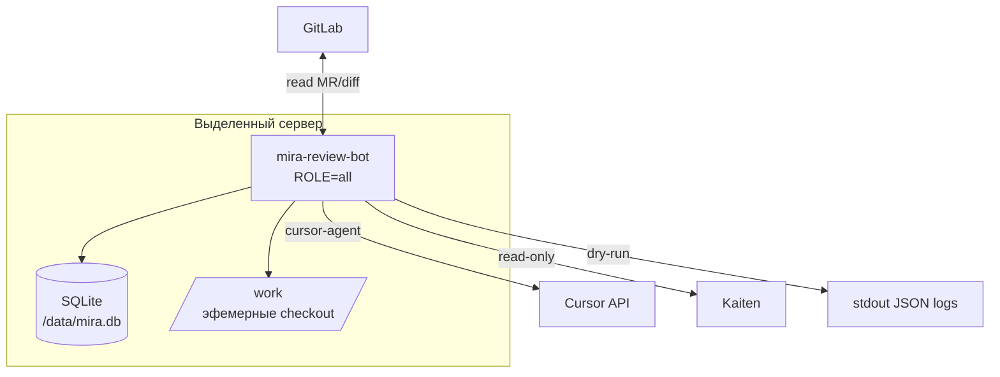
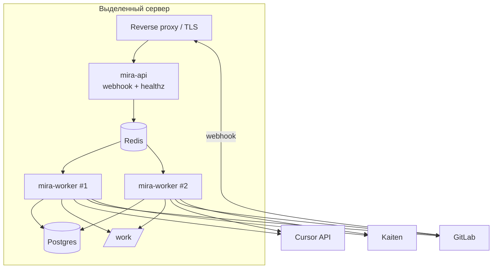

# Развёртывание

Целевая среда — **выделенный сервер** с установленным Cursor CLI (`cursor-agent`), сетевым доступом к `gitlab.ai-referent.ru`, Kaiten и Cursor API. GitLab CI/CD для самого бота не используется.

**Реализовано (фазы 0–1):** один Docker-образ, MVP-топология «всё-в-одном», polling-триггер, CLI headless-движок, SQLite state store, in-process очередь, dry-run publisher (лог).

**Запланировано:** разнесение на `api` / `worker` / `poller`, Redis, Postgres, webhook-приёмник, публикация в MR.

> **Блокер 🔑P2:** у бота `mira_review_bot` (GitLab id=30) нет доступа к пилотным репозиториям — сервис можно поднять, но poller не найдёт MR для ревью.

---

## 1. Топология процессов

### 1.1. MVP (текущая реализация)



Один контейнер (`ROLE=all`) одновременно:

- **poller** — опрашивает GitLab по списку проектов из policy, ставит `ReviewJob` в очередь;
- **worker** — выполняет пайплайн ревью (checkout → engine → publish → record);
- **api** — отдаёт `GET /healthz` на порту `HEALTH_PORT` (по умолчанию `8080`).

Очередь — **in-process** (`InProcQueue`), state store — **SQLite** (`MIRA_DB_PATH`, по умолчанию `/data/mira.db` в образе).

### 1.2. Целевая топология (будущие фазы)



Разнесение на сервисы — когда нужны параллельные воркеры, webhook и устойчивость очереди.

---

## 2. Docker-образ

Файл: `deploy/Dockerfile`.

| Компонент | Версия / примечание |
| --- | --- |
| Базовый образ | `node:24-bookworm-slim` |
| Системные пакеты | `git`, `curl`, `ca-certificates`, `proxychains4` (обёртка `cursor-agent` через SOCKS sidecar `xray`) |
| Cursor CLI | `curl -fsSL https://cursor.com/install \| bash` → `cursor-agent` в `/root/.local/bin` |
| Сборка | `npm ci` → `npm run build` → `npm prune --omit=dev` |
| Точка входа | `deploy/entrypoint.sh` → `node dist/entrypoints/main.js` |
| Порты | `8080` (`HEALTH_PORT`) |
| Тома по умолчанию | `/work` (checkout), `/data` (SQLite) |

Переменные образа по умолчанию:

```text
WORKSPACE_ROOT=/work
MIRA_DB_PATH=/data/mira.db
HEALTH_PORT=8080
```

> Перед прод-сборкой сверяйте команду установки Cursor CLI с актуальной документацией Cursor.

---

## 3. Entrypoint и роли (`ROLE`)

Файл: `deploy/entrypoint.sh` — запускает `node dist/entrypoints/main.js`. Роль выбирается переменной **`ROLE`** (см. `src/entrypoints/main.ts`).

| `ROLE` | Поведение | Фаза |
| --- | --- | --- |
| `all` | poller + worker + `/healthz` + `/admin/secrets` | **MVP (default)** |
| `poller` | Только discovery MR и enqueue | реализовано |
| `worker` | Только consume очереди и ревью | реализовано |
| `api` | `/healthz` + `/admin/secrets` + webhook | реализовано |

Неизвестное значение → fatal при старте.

Composition root при старте:

1. `loadConfig()` — обязательные секреты из ENV;
2. `loadPolicy()` — YAML из `MIRA_POLICY_CONFIG` (или defaults без пилотных проектов);
3. wiring адаптеров: `GitLabReader`, `KaitenTracker`, `SqliteStateStore`, `InProcQueue`, `CliHeadlessEngine`, `LogPublisher`.

---

## 4. docker-compose (MVP)

Файл: `deploy/docker-compose.yml` — **один сервис** `mira`:

```yaml
services:
  mira:
    build:
      context: ..
      dockerfile: deploy/Dockerfile
    image: mira-review-bot:latest
    environment:
      ROLE: all
      # секреты — из .env хоста или секрет-менеджера
      CURSOR_API_KEY: ${CURSOR_API_KEY}
      GITLAB_BASE_URL: ${GITLAB_BASE_URL}
      GITLAB_TOKEN: ${GITLAB_TOKEN}
      KAITEN_BASE_URL: ${KAITEN_BASE_URL}
      KAITEN_TOKEN: ${KAITEN_TOKEN}
      MIRA_POLICY_CONFIG: /etc/mira/config.yml
      MIRA_DB_PATH: /data/mira.db
      WORKSPACE_ROOT: /work
      MAX_CONCURRENCY: '1'
      POLL_INTERVAL_MS: '60000'
      HEALTH_PORT: '8080'
    ports:
      - '8080:8080'
    volumes:
      - mira-data:/data
      - mira-work:/work
      - ./config.yml:/etc/mira/config.yml:ro
    healthcheck:
      test: ['CMD', 'node', '-e', "fetch('http://localhost:8080/healthz').then(r=>process.exit(r.ok?0:1)).catch(()=>process.exit(1))"]
      interval: 30s
      timeout: 5s
      retries: 3
    restart: unless-stopped
```

### Запуск

```bash
cd deploy
cp config.example.yml config.yml
# отредактировать config.yml — список пилотных проектов
docker compose up -d --build
```

Секреты передаются через `.env` рядом с `docker-compose.yml` или через механизм оркестратора (Docker secrets, Vault agent и т.п.).

### Без Docker

Альтернатива — **systemd**-юниты с теми же ENV и `node dist/entrypoints/main.js`. Для MVP достаточно одного юнита с `ROLE=all`.

---

## 5. Health check

| Параметр | Значение |
| --- | --- |
| Путь | `GET /healthz`; live-ключи — `PUT /admin/secrets` (ADR 019) |
| Порт | `HEALTH_PORT` (default `8080`) |
| Ответ | `200`, `{"status":"ok"}` |
| Прочие пути | `404` (кроме webhook и `/admin/secrets`) |

**Текущее ограничение:** healthz не проверяет доступность GitLab, Kaiten, Cursor и БД — только liveness HTTP-сервера. Расширенный readiness — **будущая доработка**.

Docker Compose использует встроенный `healthcheck` (см. выше).

---

## 6. Конфигурация

Два уровня: **секреты и runtime** (ENV) и **политика ревью** (YAML).

### 6.1. Переменные окружения

Полный справочник — [environment.md](../03-reference/environment.md).

**Обязательные** (`loadConfig()` в `src/config/index.ts`):

| Переменная | Назначение |
| --- | --- |
| `CURSOR_API_KEY` | Ключ Cursor API для `cursor-agent` |
| `GITLAB_BASE_URL` | Базовый URL GitLab (без `/api/v4`) |
| `GITLAB_TOKEN` | Токен доступа (`PRIVATE-TOKEN`) |
| `KAITEN_BASE_URL` | Базовый URL Kaiten (без `/api/latest`) |
| `KAITEN_TOKEN` | Bearer-токен Kaiten (**только чтение** в MVP) |

**Операционные** (читаются в `main.ts`):

| Переменная | Default | Назначение |
| --- | --- | --- |
| `ROLE` | `all` | Роль процесса |
| `MIRA_POLICY_CONFIG` | — | Путь к YAML policy |
| `MIRA_DB_PATH` | `mira.db` | SQLite state store |
| `WORKSPACE_ROOT` | temp | Корень git checkout |
| `MAX_CONCURRENCY` | `1` | Параллельные worker-задачи |
| `POLL_INTERVAL_MS` | `60000` | Интервал poller |
| `HEALTH_PORT` | `8080` | Порт `/healthz` |
| `CURSOR_AGENT_BIN` | `cursor-agent` | Путь к бинарнику CLI |

Секреты **никогда** не кладутся в policy YAML — только ENV. См. [security.md](./security.md).

### 6.2. Policy YAML

Пример: `deploy/config.example.yml`. Монтируется в контейнер как `/etc/mira/config.yml`.

```yaml
defaults:
  review_on: [open, ready, manual]   # push/reopen — webhook-only (фаза 2)
  strictness: balanced
  ignored_globs:
    - '**/*.lock'
    - '**/package-lock.json'
    - '**/dist/**'
    - '**/*.min.js'
  context_budget:
    max_chunk_tokens: 60000
    estimate: bytes
  decomposition:
    mode: single
  model: "cursor-grok-4.6[fast=true]"

discovery:
  mode: explicit
  projects:
    - group/sub/project-a

projects:
  group/sub/project-a:
    strictness: strict
```

Подробнее о полях — [policy-config.md](../03-reference/policy-config.md).

**Enrollment (подключение репозиториев):**

| Режим | Статус | Описание |
| --- | --- | --- |
| `explicit` | **MVP** | Явный список `discovery.projects` |
| `membership` | план | Авто-discovery по членству бота в GitLab |
| `hybrid` | план | Membership + topic / opt-in файл |

Per-repo override (`.mira/config.yml` в репозитории) — **план**; глобальные ИБ-параметры из репо не переопределяются.

---

## 7. Сетевые требования

| Направление | Откуда | Куда | Зачем | Фаза |
| --- | --- | --- | --- | --- |
| Egress | mira | GitLab | read MR, diff, clone | **0–1** |
| Egress | mira | Kaiten | read карточки, критерии | **0–1** |
| Egress | mira | Cursor API | инференс модели | **0–1** |
| Ingress | GitLab | mira:8080 (через TLS proxy) | webhooks | **фаза 2** |
| Egress write | mira | GitLab | публикация в MR | **фаза 2** |

Egress в Cursor API — разрешён политикой ИБ. См. [security.md](./security.md) и [ADR 011](../04-architecture/adr/011-cursor-api-egress-allowed.md).

---

## 8. Расчёт мощности сервера

### 8.1. Принцип

Инференс модели выполняется **на стороне Cursor API**, не на нашем сервере. GPU не нужен. Узкие места — число параллельных ревью (CPU/RAM) и квоты Cursor API.

### 8.2. Бюджет на один слот ревью

| Ресурс | На 1 слот | Комментарий |
| --- | --- | --- |
| vCPU | ~0.5 эфф., резерв 1.0 | Бурсты; в простое ждёт сеть |
| RAM | ~2 ГБ | Node + git + MCP |
| Диск `/work` | ~2–3 ГБ | Эфемерный checkout, GC после задачи |
| Длительность | ~3–8 мин | В основном ожидание модели |

### 8.3. Фон (MVP, SQLite)

| Компонент | vCPU | RAM |
| --- | --- | --- |
| ОС + Docker | 0.5 | 0.5–1 ГБ |
| mira (`ROLE=all`) | 0.25–0.5 | 0.5–1 ГБ |
| SQLite | пренебрежимо | пренебрежимо |
| **Итого фон** | **~1 vCPU** | **~2 ГБ** |

С Redis + Postgres (будущее) добавьте ~1 vCPU / ~1–2 ГБ.

### 8.4. Рекомендуемые тиры

| Тир | MR/день | Параллелизм | vCPU | RAM | Диск | Топология |
| --- | --- | --- | --- | --- | --- | --- |
| **S — пилот** | до ~30 | 1–2 | **2–4** | **4–8 ГБ** | 60 ГБ | 1 контейнер `all` |
| **M — команда** | ~100–150 | 4–6 | **8** | **16 ГБ** | 150 ГБ | api + 2–3 worker |
| **L — несколько команд** | ~400+ | 12–16 | **16–24** | **48–64 ГБ** | 400 ГБ | горизонтальные worker |

Ограничивайте нагрузку через `MAX_CONCURRENCY` — лучше очередь, чем OOM.

> Основная «стоимость» — подписка/токены Cursor, а не железо сервера.

---

## 9. Эксплуатация

| Задача | MVP | Будущее |
| --- | --- | --- |
| Health | `/healthz` + Docker healthcheck | readiness deps |
| Логи | stdout JSON → централизованный сбор | см. [observability.md](./observability.md) |
| Бэкап | том `mira-data` (SQLite) | Postgres dump |
| Обновление образа | `docker compose build && up -d` | rolling update worker |
| GC воркспейсов | cleanup после каждого job | TTL-сборщик `/work` |
| Rate limiting | через `POLL_INTERVAL_MS`, `MAX_CONCURRENCY` | per-project лимиты |

### Graceful shutdown

По `SIGINT` / `SIGTERM`: abort poller/worker, закрытие очереди, `store.close()`, лог `shutdown.complete`.

### Минимальная установка MVP (чек-лист)

1. Собрать образ из `deploy/Dockerfile`.
2. Заполнить ENV-секреты (см. `.env.example`).
3. Скопировать и настроить `config.yml` — указать реальные пути пилотных проектов.
4. **Выдать боту доступ** к этим проектам в GitLab (🔑P2).
5. `docker compose up -d`; проверить `curl localhost:8080/healthz`.
6. Наблюдать логи: `poller.start`, затем `review.*` при появлении MR.

---

## См. также

- [security.md](./security.md) — секреты, egress, изоляция
- [observability.md](./observability.md) — логи и метрики
- [environment.md](../03-reference/environment.md) — справочник ENV
- [roadmap.md](../01-concepts/roadmap.md) — фазы webhook, publish, Postgres
