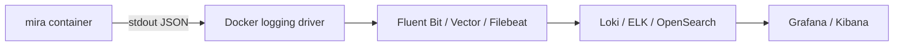

# Наблюдаемость

Mira работает автономно и неинтерактивно — наблюдаемость нужна, чтобы ответить: **что бот сделал на MR, почему, сколько это заняло и где ошибка**.

**Реализовано (фазы 0–1):** структурные JSON-логи в stdout, автоматический redaction, in-memory registry метрик с `snapshot()`.

**Запланировано:** экспорт Prometheus, OpenTelemetry-трейсы, дашборды, алертинг, продуктовые метрики (accepted/dismissed findings).

---

## 1. Корреляция

Сквозные поля для связи событий одного ревью:

| Поле | Источник | Статус |
| --- | --- | --- |
| `project_id`, `mr_iid`, `head_sha` | `ReviewJob` | **логируется** |
| `service`, `role` | base logger (`main.ts`) | **логируется** |
| `dry_run: true` | `LogPublisher` child logger | **логируется** |
| `review_id` | домен (план) | — |
| `run_id`, `agent_id` | Cursor CLI/SDK | **план** — сразу после старта engine |
| `model`, `prompt_version` | policy / constants | частично (`prompt_version` в idempotency key) |

Рекомендация для расследования: фильтровать логи по `project_id` + `mr_iid` + `head_sha` или по сообщениям `review.done` / `review.summary`.

---

## 2. Структурные логи

### 2.1. Формат

Модуль `src/observability/logger.ts` — одна JSON-строка на событие в stdout:

```json
{
  "ts": "2026-06-21T12:00:00.000Z",
  "level": "info",
  "msg": "review.done",
  "service": "mira",
  "role": "all",
  "project_id": "group/sub/project-a",
  "mr_iid": 42,
  "head_sha": "a1b2c3d",
  "verdict": "issues",
  "findings": 3,
  "units": 1
}
```

API:

- уровни: `debug`, `info`, `warn`, `error`;
- `logger.child({ ... })` — добавляет поля корреляции (используется в `LogPublisher`);
- каждая строка проходит через `redact()` перед записью.

### 2.2. Ключевые сообщения (реализовано)

| `msg` | Компонент | Когда |
| --- | --- | --- |
| `healthz.listening` | `main.ts` | Старт HTTP health |
| `poller.start` | `main.ts` | Старт poller (`projects`, `interval_ms`) |
| `worker.start` | `main.ts` | Старт worker (`concurrency`) |
| `review.skip.seen` | pipeline | Idempotency — уже обработано |
| `review.empty` | pipeline | Нет reviewable diff |
| `review.unit.error` | pipeline | Ошибка engine на unit |
| `review.normalized` | pipeline | После normalize (`units`, `dropped`) |
| `review.done` | pipeline | Успешное завершение |
| `review.summary` | LogPublisher | Dry-run итог (`verdict`, `by_severity`) |
| `review.finding` | LogPublisher | Каждая finding |
| `review.requirement` | LogPublisher | Coverage критериев Kaiten |
| `review.degraded` | LogPublisher | Деградации агрегации |
| `poller.error` / `worker.error` | poller/worker | Ошибки фоновых циклов |
| `shutdown.signal` / `shutdown.complete` | `main.ts` | Graceful shutdown |

**План (из дизайна):** `trigger.received`, `job.enqueued`, `context.built`, `workspace.prepared`, `engine.start`, `engine.done`, `publish.done`, `job.failed`, `job.retry`.

### 2.3. Redaction

`src/observability/redact.ts` — deep-clone маскирование:

| Тип данных | Поведение |
| --- | --- |
| Поля `*token*`, `*apikey*`, `authorization` | `***` |
| OAuth2 в URL | `oauth2:***@` |
| Строки ≥32 символов, похожие на секреты | `***` |
| Поля `diff`, `prompt` | `<diff N bytes>` / `<prompt N bytes>` |

**Не логировать** полные diff и содержимое файлов — объём и конфиденциальность.

---

## 3. Метрики

### 3.1. In-memory registry (реализовано)

Модуль `src/observability/metrics.ts` — синхронные counters и histograms в процессе. Экспорт — метод `snapshot()`:

```typescript
interface MetricsSnapshot {
  counters: CounterSnapshot[];    // name, labels, value
  histograms: HistogramSnapshot[]; // name, labels, count, sum, min, max
}
```

Имена (`METRIC_NAMES`):

| Имя | Тип | Подключение в MVP |
| --- | --- | --- |
| `reviews_total` | counter | `main.ts` → `onReviewStart` |
| `review_duration_seconds` | histogram | `main.ts` → `onReviewDone` |
| `engine_errors_total` | counter | `main.ts` → `onEngineError` |
| `review_units_total` | counter | `main.ts` → `onReviewDone` (unit count) |
| `tokens_used_total` | counter | **объявлено**, wiring — **план** |

**План:** HTTP `/metrics` (Prometheus), labels `{trigger, result}`, queue depth, token cost.

### 3.2. Операционные метрики (целевой набор)

| Метрика | Тип | Зачем | Статус |
| --- | --- | --- | --- |
| `reviews_total{trigger,result}` | counter | Объём и успехи/ошибки | частично |
| `review_duration_seconds` | histogram | Латентность end-to-end | **да** |
| `engine_duration_seconds` | histogram | Время агента | план |
| `queue_depth` / `queue_wait_seconds` | gauge/histogram | Перегрузка | план (in-proc) |
| `engine_errors_total` | counter | Ошибки engine | **да** |
| `retries_total` / `deadletter_total` | counter | Здоровье повторов | план |
| `tokens_used_total` | counter | Стоимость Cursor | план |
| `review_units_total` | counter | Декомпозиция MR | **да** |
| `workspace_disk_bytes` | gauge | Ёмкость `/work` | план |

### 3.3. Продуктовые метрики (будущее)

| Метрика | Зачем |
| --- | --- |
| `findings_total{severity,category}` | Профиль находок |
| `findings_accepted` / `findings_dismissed` | Полезность |
| `false_positive_rate` | Качество (по `@mira ignore`, резолвам) |
| `requirements_coverage{status}` | met / partial / missing |
| `duplicate_comments` | Контроль идемпотентности публикации |

Сигнал обратной связи от разработчиков — вход для настройки strictness и промпта.

---

## 4. Трассировка (план)

OpenTelemetry-трейс на `review_id` со спанами:

`context build → workspace → engine → publish`

Удобно для поиска «где тратится время» на медленных MR.

---

## 5. Аудит

### 5.1. Логи (фаза 0–1)

`LogPublisher` пишет полный dry-run отчёт:

- `review.summary` — verdict, counts по severity;
- `review.finding` — каждая finding с path, severity, message;
- `review.requirement` — статус критериев Kaiten;
- `review.degraded` — если часть units упала.

Это позволяет воспроизвести, **что бы** бот опубликовал, без записи в MR.

### 5.2. State store (фаза 0–1)

SQLite (`SqliteStateStore`) хранит idempotency: какой `ReviewKey` (`head_sha` + `prompt_version` + `partition_version`) уже обработан и результат.

### 5.3. Публикация (фаза 2+)

План: неизменяемая запись «что опубликовано» — fingerprint находок, id дискуссий GitLab, `model`, `prompt_version`.

См. также [security.md](./security.md) §8.

---

## 6. Алертинг (план)

| Условие | Действие |
| --- | --- |
| Рост `engine_errors_total` | Проблема auth / сети / Cursor API |
| `deadletter_total` растёт | Задачи не обрабатываются |
| `queue_wait_seconds` выше порога | Нехватка воркеров |
| `reviews_total{result=ok}` → 0 | Сервис «молчит» (poller idle / нет доступа 🔑P2) |
| `duplicate_comments > 0` | Регресс идемпотентности |
| `/healthz` недоступен | Контейнер упал |
| GitLab / Kaiten / Cursor недоступны | readiness check (план) |

Интеграция — Prometheus Alertmanager, Grafana OnCall или корпоративный мониторинг.

---

## 7. Дашборды (план)

Минимальный набор панелей:

1. **Поток:** reviews/min, latency p50/p95.
2. **Здоровье:** `engine_errors_total`, retries, healthz uptime.
3. **Стоимость:** `tokens_used_total` по проектам.
4. **Полезность:** findings по severity, accepted vs dismissed.

До появления Prometheus достаточно grep/ELK/Loki по JSON-логам и периодического `metrics.snapshot()` (при добавлении debug-эндпоинта).

---

## 8. Сбор логов в prod



Рекомендации:

- не включать debug в prod без необходимости;
- ротация на стороне агента или драйвера;
- сохранять поля `ts`, `level`, `msg`, `project_id`, `mr_iid`, `head_sha`.

---

## 9. Локальная отладка

- PoC одного MR: `npm run poc` — те же логи и redaction ([cli.md](../03-reference/cli.md)).
- Тесты: `src/observability/observability.test.ts` — redaction и metrics snapshot.

---

## См. также

- [deployment.md](./deployment.md) — healthcheck, docker logging
- [security.md](./security.md) — что не логировать
- [environment.md](../03-reference/environment.md) — `HEALTH_PORT`, `ROLE`
