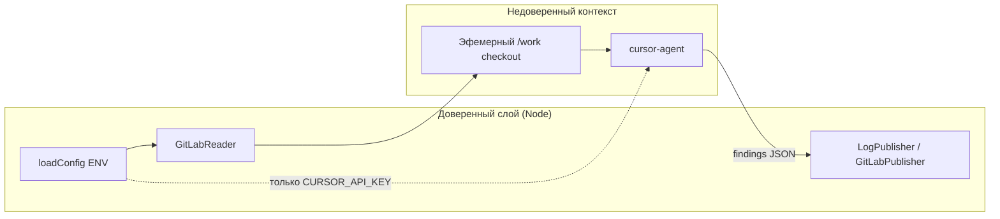

# Безопасность

Mira имеет доступ к исходному коду, задачам Kaiten и (в будущих фазах) право писать в MR — это чувствительный периметр. Документ описывает модель угроз, работу с секретами, изоляцию и меры против prompt injection.

**Текущая фаза (0–1):** GitLab — только **read**; publisher — **dry-run** (без записи в MR); Kaiten — **строго read-only** под личным токеном.

---

## 1. Активы и угрозы

| Актив | Угроза | Мера |
| --- | --- | --- |
| Исходный код | Утечка во внешние сервисы | Контроль egress; передача в Cursor API — **разрешена** политикой ИБ ([ADR 011](../04-architecture/adr/011-cursor-api-egress-allowed.md)); cloud-движок в приватном контуре — по умолчанию выключен |
| Токены (GitLab/Kaiten/Cursor) | Кража / утечка | Только ENV / секрет-менеджер; не в VCS; ротация; минимальный scope |
| Право записи в MR | Спам, вредные комментарии | **Фаза 2:** только Publisher под bot-аккаунтом; агент без write-инструментов |
| Webhook-эндпоинт | Подделка событий, DoS | **Фаза 2:** секрет-токен, IP-allowlist, rate-limit |
| Выполнение агента | Влияние недоверенного кода из MR | Эфемерный воркспейс; секреты write-слоя не в env агента |
| Prompt injection | Манипуляция выводом ревью | Жёсткая роль; детерминированный Publisher; валидация схемы findings |

---

## 2. Секреты

### 2.1. Хранение и загрузка

Секреты загружаются из переменных окружения через `loadConfig()` (`src/config/index.ts`). Перед валидацией process читает `MIRA_ENV_FILE` (дефолт `.env`) в **пустые** ключи — уже заданные ENV (Docker, systemd) не перезаписываются.

| Переменная | Назначение |
| --- | --- |
| `CURSOR_API_KEY` | Cursor API |
| `GITLAB_TOKEN` | GitLab API (`PRIVATE-TOKEN`) |
| `KAITEN_TOKEN` | Kaiten API (Bearer) |

Отсутствие любой обязательной переменной после загрузки файла → `ConfigError` и немедленный выход.

Ротация без рестарта: `PUT /admin/secrets` (ADR 019). Значения в ответах и логах не возвращаются; GET показывает только `set`/`missing`. Если `MIRA_ADMIN_TOKEN` пуст, эндпоинт принимает **только loopback**. С опубликованным портом (Docker `HEALTH_PUBLISH`) задайте `MIRA_ADMIN_TOKEN`.

**Запрещено:**

- хранить секреты в git, образах, `deploy/config.yml`, `.mira/config.yml` репозиториев;
- логировать значения токенов (см. redaction ниже).

**Рекомендуется:**

- секрет-менеджер (Vault, Docker secrets) или `.env` с правами `600` на хосте;
- плановая ротация ключей;
- явная передача `CURSOR_API_KEY` в env процесса `cursor-agent` (не «магическое» чтение из недокументированных путей).

Policy YAML (`MIRA_POLICY_CONFIG`) содержит **только** политику ревью — приходит из доверенного админ-конфига на сервере, не из ревьюируемых репозиториев.

### 2.2. Маскирование в логах

Модуль `src/observability/redact.ts` применяется ко **всем** строкам JSON-лога (`createLogger`):

- поля с именами `*token*`, `*apikey*`, `authorization` → `***`;
- OAuth2 URL `oauth2:…@` → маскировка credentials;
- строки длиной ≥32 символов, похожие на секреты → `***`;
- поля `diff`, `prompt` → `<diff N bytes>` / `<prompt N bytes>` (без содержимого).

Подробнее — [observability.md](./observability.md).

---

## 3. Учётные записи и минимальные привилегии

### 3.1. GitLab — bot-аккаунт Mira

| Параметр | Значение |
| --- | --- |
| Username | `mira_review_bot` |
| GitLab user id | **30** |
| Назначение | Единый сервис-аккаунт: enrollment по членству, read MR, **write в MR (фаза 2)** |

**Текущий блокер 🔑P2:** боту не выданы доступы к пилотным репозиториям — живые прогоны невозможны.

| Scope | Фаза 0–1 | Фаза 2+ |
| --- | --- | --- |
| Членство в проектах/группах | нужно для read | то же |
| Read repository | да | да |
| Read/ write MR notes & discussions | read only | write через Publisher |
| Approve / unapprove MR (бот) | нет | консультативный сигнал при `verdict: ok` (не required rule) |

Не использовать личные токены разработчиков для prod-сервиса.

Токен в ENV: `GITLAB_TOKEN` (read в MVP; тот же аккаунт получит write при включении публикации).

### 3.2. Kaiten — строго read-only

| Параметр | Значение |
| --- | --- |
| Токен | `KAITEN_TOKEN` — **личный** токен (@dev.konin) в MVP |
| Разрешено | GET карточки, описание, критерии приёмки, чек-листы |
| Запрещено | comments, external links, смена статусов, create/update/delete |

Адаптер `KaitenTracker` реализует только чтение. Запись обратной связи — **фаза 3+** под отдельным сервис-аккаунтом.

См. [ADR 008](../04-architecture/adr/008-kaiten-read-only.md) и rule `.cursor/rules/kaiten-read-only.mdc`.

### 3.3. Cursor API

| Параметр | Значение |
| --- | --- |
| Ключ | `CURSOR_API_KEY` |
| Модель | `cursor-grok-4.6[fast=true]` (из policy defaults) |
| Egress | Код MR передаётся в Cursor API — **разрешено** политикой ИБ |

---

## 4. Изоляция выполнения агента

Агент (`cursor-agent`) работает с **недоверенным** содержимым MR:

**Реализовано (MVP):**

- эфемерный воркспейс на задачу, удаляется в `finally` пайплайна;
- в env агента передаётся только `CURSOR_API_KEY` (явно из composition root);
- агент **не пушит и не мёржит**;
- publisher dry-run — **нет** side effects в GitLab/Kaiten.

**План:**

- sandbox / отдельный контейнер на задачу;
- сетевые ограничения для процесса агента (только Cursor API + MCP read);
- запрет доступа к диску за пределами воркспейса.

---

## 5. Защита от prompt injection

Содержимое репозитория, описания MR и комментариев — **недоверенный ввод**.

| Мера | Статус |
| --- | --- |
| Системная роль: агент анализирует, не исполняет инструкции из кода/MR | промпт `prompts/review.v1.md` |
| Агент формирует findings; публикация — решение Publisher по схеме | **реализовано** |
| Агент без write-инструментов в MR / Kaiten | **реализовано** |
| Валидация вывода по `findings.schema.json` | **реализовано** |
| Нет побочных эффектов по тексту из MR (статусы, задачи, push) | **реализовано** |

---

## 6. Webhook-безопасность (фаза 2)

Планируемые меры для `src/entrypoints/api/`:

- проверка `X-Gitlab-Token` против `GITLAB_WEBHOOK_SECRET`;
- IP-allowlist на reverse-proxy (GitLab во внутренней сети);
- TLS на ingress;
- быстрый `200 OK` после enqueue; тяжёлая работа — асинхронно;
- dedup + debounce против штормов событий;
- redaction payload в логах.

---

## 7. Приватность кода и egress

При local-runtime (CLI headless) diff и контекст MR отправляются в **Cursor API**.

**Решение:** передача разрешена — основа архитектуры ([ADR 011](../04-architecture/adr/011-cursor-api-egress-allowed.md)).

Меры гигиены:

- firewall egress: только домены GitLab, Kaiten, Cursor API;
- точечное отключение: `projects.<path>.enabled: false` в policy;
- при изменении политики ИБ — запасной путь self-hosted модели ([roadmap.md](../01-concepts/roadmap.md)).

---

## 8. Аудит и подотчётность

| Что фиксируется | Где | Фаза |
| --- | --- | --- |
| `project_id`, `mr_iid`, `head_sha`, `verdict`, findings | JSON-логи (`LogPublisher`) | **0–1** |
| Idempotency key (`prompt_version`, `partition_version`) | SQLite state store | **0–1** |
| Кто опубликовал комментарий в MR | GitLab history от bot-аккаунта | **фаза 2** |
| `run_id` / `agent_id` Cursor | логи engine (план) | частично |

---

## 9. Supply chain

- Pin версий в `package-lock.json`; контролируемое обновление зависимостей.
- Базовый образ `node:24-bookworm-slim` из доверенного registry; сканирование на CVE.
- Скрипт установки Cursor CLI — фиксировать URL (`https://cursor.com/install`), проверять при сборке образа.
- `npm ci` + `npm prune --omit=dev` в Dockerfile — без dev-зависимостей в runtime.

---

## 10. Чек-лист перед продом

- [ ] Секреты в секрет-менеджере / ENV, не в VCS; права файлов корректны.
- [ ] Bot-аккаунт `mira_review_bot` (id=30) с минимальным scope; доступ к пилотным репо (**🔑P2**).
- [ ] `KAITEN_TOKEN` — только read; нет write-вызовов в адаптере.
- [ ] Egress firewall: Cursor API / GitLab / Kaiten.
- [ ] Эфемерные воркспейсы; write-токены не в env `cursor-agent`.
- [ ] Publisher dry-run или контролируемый rollout write (фаза 2).
- [ ] Redaction секретов и diff в логах проверен на тестовом прогоне.
- [ ] Согласована передача кода в Cursor API.
- [ ] (Фаза 2) Webhook secret + IP-allowlist + TLS.

---

## См. также

- [deployment.md](./deployment.md) — топология и ENV
- [observability.md](./observability.md) — логи и аудит-трейл
- [integrations-api.md](../03-reference/integrations-api.md) — поверхность адаптеров
- [environment.md](../03-reference/environment.md) — переменные окружения
