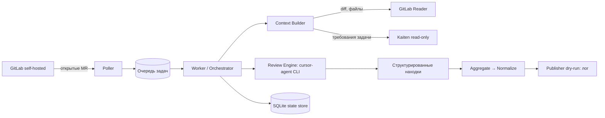

# Mira Review Bot — документация

**Mira** — автономный сервис AI-код-ревью для Merge Request в self-hosted GitLab.
Запускается на выделенном сервере, использует **Cursor** (`cursor-agent` / Composer 2.5)
как «движок мышления» и ревьюит код **в контексте задачи Kaiten** (описание, критерии
приёмки), ища баги, регрессии, проблемы безопасности/производительности и расхождения
с требованиями.

> Документация реорганизована по стандарту репозитория (`.cursor/rules/docs-structure.mdc`):
> разделы — нумерованные директории `NN-kebab-case/`, порядок папок = порядок чтения.
> Сжатый снимок для AI-агентов — [`_ai/`](./_ai/README.md); статус задач — [`tasks/`](../tasks/README.md).

## Разделы

| # | Раздел | О чём | Точка входа |
| --- | --- | --- | --- |
| 00 | [Onboarding](./00-onboarding/README.md) | Быстрый старт: prerequisites, env, первый запуск, команды | [README](./00-onboarding/README.md) |
| 01 | [Concepts](./01-concepts/README.md) | Обзор продукта, требования, глоссарий домена, дорожная карта | [overview](./01-concepts/overview.md) |
| 02 | [Guides](./02-guides/README.md) | How-to: PoC-ревью, настройка policy, локальная разработка | [run-review-poc](./02-guides/run-review-poc.md) |
| 03 | [Reference](./03-reference/README.md) | Факты: env, порты, домен, схема находок, policy, CLI, API | [environment](./03-reference/environment.md) |
| 04 | [Architecture](./04-architecture/README.md) | Гексагон, пайплайн ревью, триггеры, декомпозиция, **ADR** | [overview](./04-architecture/overview.md) · [adr](./04-architecture/adr/README.md) |
| 05 | [Operations](./05-operations/README.md) | Деплой, безопасность, наблюдаемость | [deployment](./05-operations/deployment.md) |

## Как читать

- Новичку — начните с [00-onboarding](./00-onboarding/README.md), затем
  [01-concepts/overview](./01-concepts/overview.md).
- За фактами (env, типы, схемы, флаги) — [03-reference](./03-reference/README.md).
- «Почему так устроено» — [04-architecture](./04-architecture/README.md) и
  записи решений в [04-architecture/adr](./04-architecture/adr/README.md).
- Эксплуатация — [05-operations](./05-operations/README.md).

## TL;DR архитектуры

Реализованы фазы **0 (PoC)** и **1 (MVP: polling + CLI-движок + dry-run publisher)**.
Publisher пока только логирует и **не пишет** в GitLab/Kaiten. Детали фаз и статус
задач — [01-concepts/roadmap](./01-concepts/roadmap.md) и
[`tasks/execution-order.md`](../tasks/execution-order.md).

## Связанные материалы

- [`_ai/`](./_ai/README.md) — Memory Bank (сжатый снимок для AI-агентов).
- [`../AGENTS.md`](../AGENTS.md) — точка входа для AI-агентов в репозитории.
- [`../tasks/`](../tasks/README.md) — план реализации по фазам и порядок выполнения.
